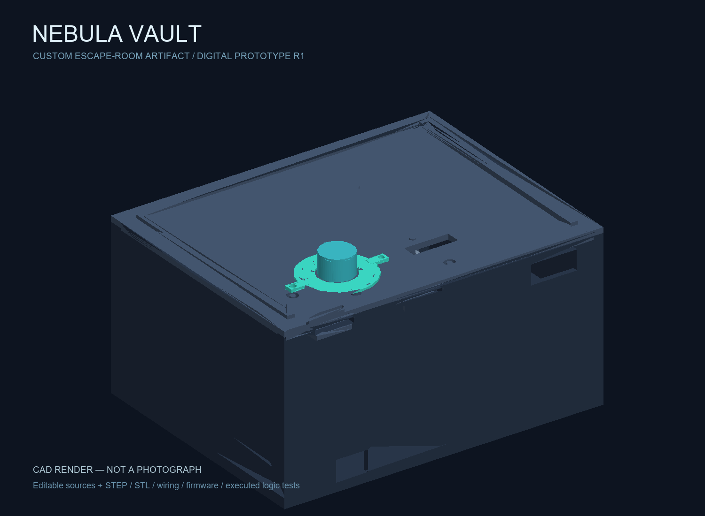
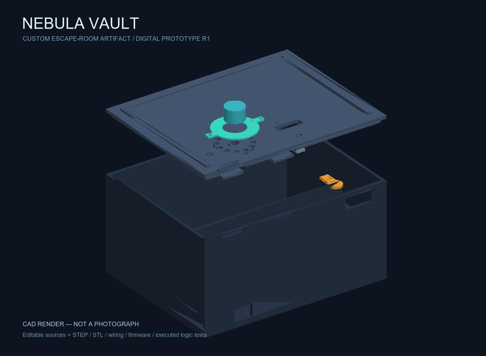
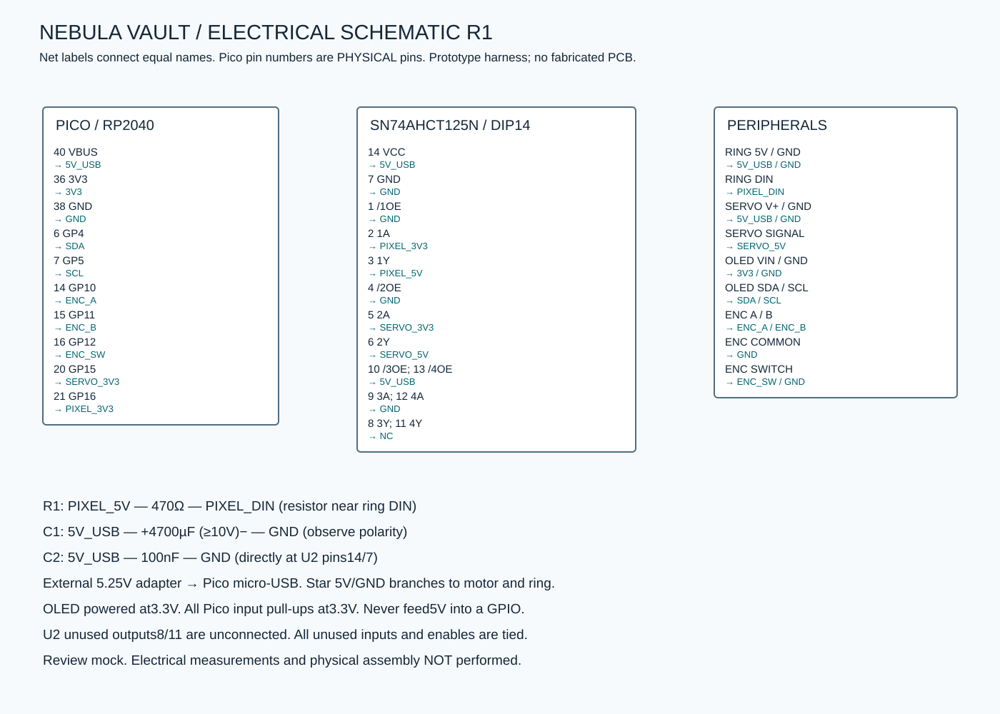

# NEBULA VAULT
### Recover the core. Decode the orbit. Break the pulse.

**Yonathan’s NebulaVault — design-stage submission package.** NebulaVault is Yonathan’s project, prepared for a Half-Life Week 5 design submission. The owner confirmed 20 hours of personal NebulaVault design work on November 8, 2026; no session dates or hour-by-hour allocations were supplied. Original project author: Yonathan. Physical build and bench testing remain unperformed. Submission acceptance and compliance are not established by this package. See [verified rules](docs/VERIFIED-CHALLENGE.md) and [requirement audit](docs/TIER3-AUDIT.md).



Nebula Vault is an escape-room artifact disguised as a spacecraft salvage container. A glowing dial and a narrow status screen are the only controls. The player restores three orbital signals, watches a pulse pattern, and reproduces it to release a hidden mechanical latch. The ending is physical: solve the sequence, hear the servo move, and lift the lid to recover the core.

The project combines a custom enclosure, printed light diffuser, retaining tongues, servo horn extension, and two-stage puzzle firmware. Standard components provide the processor, light, display and movement; the mechanics and interaction were designed together for this project.

### Play sequence

1. Close the empty box and press the dial to arm it.
2. Turn clockwise to **03**, then press. Turn counterclockwise to **08**, then press. Turn clockwise to **01**, then press.
3. Watch four flashes. After playback finishes, make a starting tap, then reproduce three gaps: **450 ms, 900 ms, 450 ms**. Each gap allows ±180 ms.
4. Success releases the latch. An incorrect position, direction or rhythm restarts the puzzle after 1.5 seconds. Hold the button for 2.5 seconds to request release and reset.

This is a puzzle prop, not a secure safe. A rear access slot allows the horn to be moved with a blunt tool when power is disconnected.

### How it works

The 180 × 140 mm shell separates the electronics bay from the storage compartment. A Raspberry Pi Pico reads a quadrature encoder and its push switch, drives a 12-pixel RGB ring, updates a 128 × 32 OLED, and commands an SG92R servo. A 5 V AHCT buffer shifts both the pixel data and servo signal. The OLED and its I2C pull-ups stay at 3.3 V.

The lid first engages two rear retaining tongues. At the front of the electronics bay, a servo horn extension rotates beneath a printed keeper. A correct solution turns the extension sideways so the front can lift. Servo pulses stop after 650 ms; the latch must be verified to remain stable without continuous holding torque. Boot and a long press request an open position. Power loss cannot move the servo, which is why the manual access slot matters.



### Project files

| Folder | Contents |
|---|---|
| `cad/` | Editable CadQuery model, STEP assembly, individual STEP parts and seven printable STLs |
| `firmware/` | Complete MicroPython application, pure puzzle engine and minimal OLED driver |
| `electronics/` | Editable SVG schematic, exact connection netlist and pin-by-pin wiring guide |
| `simulation/` | Repeatable simulation using the actual firmware engine and an executed solution trace |
| `procurement/` | Detailed BOM, price and stock notes, cart evidence and unresolved costs |
| `docs/` | Assembly, troubleshooting, submission answers, existing digital preparation notes and Tier 3 audit |
| `evidence/` | Executed test logs and source observations, separate from hypothetical bench work |

There is no custom manufactured PCB in this version. The circuit is intended for a soldered Perma-Proto harness; no PCB layout, Gerbers or PCB fabrication check is claimed.



### Build instructions

Start with the [assembly and acceptance guide](docs/BUILD-AND-TEST.md). Print the fit coupon, measure the purchased components, adjust the source if needed, print the parts, wire the harness, load MicroPython, and calibrate the servo with the lid removed. The guide includes a complete troubleshooting table and the physical tests still required.

The model source runs with CadQuery 2.8:

```console
python -m pip install cadquery==2.8.0
python cad/model.py
```

Install the official stable [MicroPython firmware for RP2040 Pico](https://micropython.org/download/RPI_PICO/), then copy `main.py`, `core.py` and `oled.py` to the Pico. No external Python libraries are required on the device. Use a data-capable USB cable for programming. Disconnect the motor and light-ring power while using computer USB; use the external supply for operation.

### Verification

From this project folder:

```console
python -m unittest discover -s tests -v
python simulation/run.py
```

The executed desktop suite covers a complete solution, direction and position errors, missing movement, timing boundaries, timeouts, reset behavior, and RGB limits. The simulation imports the same `core.py` used on the Pico. It does not simulate electrical signals, motor torque or printer tolerances.

The CAD report checks valid solids and digital interference. Early lid/horn collisions were corrected, and the disconnected encoder island was replaced with twelve light ports. See `cad/geometry-report.json` for the final measured **model** results. These are mathematical checks, not physical measurements.

### Bill of materials

| Ref | Exact part / purchase package | Buy qty | Unit USD | Extended USD | Vendor |
|---|---|---:|---:|---:|---|
| U1 | Pico RP2040 with loose headers — 4883 | 1 | $5.00 | $5.00 | [Adafruit](https://www.adafruit.com/product/4883) |
| ENC1 | 24-pulse encoder with push switch and knob — 377 | 1 | $4.50 | $4.50 | [DigiKey](https://www.digikey.com/en/products/detail/adafruit-industries-llc/377/7902287) |
| LED1 | NeoPixel 12 RGB ring — 1643 | 1 | $8.95 | $8.95 | [DigiKey](https://www.digikey.com/en/products/detail/adafruit-industries-llc/1643/5154677) |
| DISP1 | 128x32 SSD1306 I2C OLED — 4440 | 1 | $12.50 | $12.50 | [DigiKey](https://www.digikey.com/en/products/detail/adafruit-industries-llc/4440/10824271) |
| M1 | TowerPro SG92R micro servo with horns and screws — 169 | 1 | $5.95 | $5.95 | [Adafruit](https://www.adafruit.com/product/169) |
| U2 | 5V TTL-input quad buffer, DIP14 — SN74AHCT125N | 1 | $0.95 | $0.95 | [DigiKey](https://www.digikey.com/en/products/detail/texas-instruments/SN74AHCT125N/375798) |
| C1 | 4700uF >=10V radial electrolytic — 1589 | 1 | $1.95 | $1.95 | [Adafruit](https://www.adafruit.com/product/1589) |
| C2 | 100nF 50V X7R radial decoupling capacitor — K104K15X7RF5TL2 | 1 | $0.29 | $0.29 | [DigiKey](https://www.digikey.com/en/products/detail/vishay-beyschlag-draloric-bc-components/K104K15X7RF5TL2/286538) |
| R1 | 470-ohm 1/4W 5% axial resistor — CF14JT470R | 1 | $0.10 | $0.10 | [DigiKey](https://www.digikey.com/en/products/detail/stackpole-electronics-inc/CF14JT470R/1830342) |
| PROTO1 | Half-size Perma-Proto solder board — 1609 | 1 | $4.50 | $4.50 | [Adafruit](https://www.adafruit.com/product/1609) |
| WIRE1 | Female-female 150mm jumper wires, pack of 20 — 1950 | 2 | $1.95 | $3.90 | [DigiKey](https://www.digikey.com/en/products/detail/adafruit-industries-llc/1950/6827084) |
| PWR1 | 5.25V 2.5A supply with Micro-USB cable, US plug — 1995 | 1 | $8.25 | $8.25 | [DigiKey](https://www.digikey.com/en/products/detail/adafruit-industries-llc/1995/7902284) |
| HW1 | M3 nylon screws/nuts/standoffs 420-piece assortment — 4685 | 1 | $16.95 | $16.95 | [DigiKey](https://www.digikey.com/en/products/detail/adafruit-industries-llc/4685/13180686) |
| PRINT1 | Custom PLA body, lid, horn extension, OLED strap, dial cap and fit coupon — NebulaVault R1: six named STL files | 1 | Unknown | Unknown | [Local FDM printing — quote required](cad/model.py) |
| PRINT2 | Custom natural/translucent PLA diffuser — NebulaVault R1 diffuser.stl | 1 | Unknown | Unknown | [Local FDM printing — quote required](cad/diffuser.stl) |
| TIES1 | 2.5mm wide, 99mm long nylon locking cable tie — PLT1M-C | 4 | $0.25 | $1.00 | [DigiKey](https://www.digikey.com/en/products/detail/panduit-corp/PLT1M-C/280033) |
| USB1 | USB-A to Micro-B data cable, 3 foot — 592 | 1 | $2.95 | $2.95 | [Adafruit](https://www.adafruit.com/product/592) |
| CONSUMABLES | Workshop allocation: solder, insulation/heat-shrink, insulating mounting tape/shims — See build guide for required use; existing stock unverified | 1 | Unknown | Unknown | Workshop stock or local supply — not priced |

Known merchandise subtotal: **$77.74 USD**. With DigiKey shipping and tariff estimates, the known combined amount is **$82.88**. Adafruit shipping, sales tax, printing and workshop consumables remain unknown. The two real carts match all 15 priced BOM lines. See [cart evidence](procurement/CARTS.md) and [cost notes](procurement/BOM.md). No budget-compliance claim is made.

### Development status

The deliverable is a digital prototype with real source files and executed software/CAD checks. No printed device, soldered board, physical fit, torque, temperature, voltage waveform or endurance result is claimed. The existing digital notes are retained as preparation evidence, not converted into invented participant sessions.

The authenticated challenge is Week 5 Freestyle. Tier 3 requires genuine participant work, at least 20 design hours, required evidence, and reviewer approval. The owner confirmed 20 actual hours; original design authorship is credited to Yonathan. Four labeled videos are included. Publication and submission status are recorded separately; no purchase or approval is claimed.
