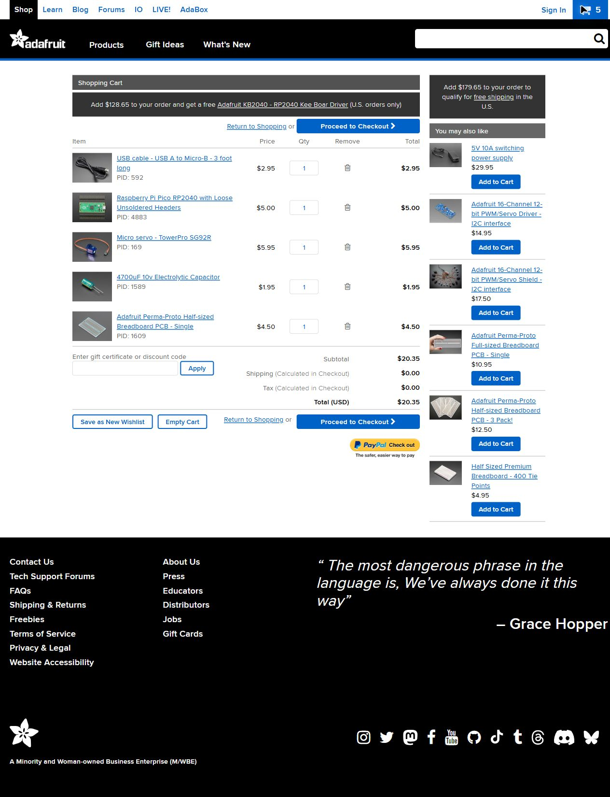
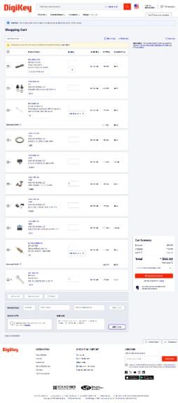

# Existing preparation note — carts and final review

Existing design record supplied by the project owner; no additional hours or session dates are invented.

The vendor review found two practical supply problems. DigiKey's Perma-Proto was backordered, so I removed that line and added the same board at Adafruit, where it showed stock. Adafruit's 470-ohm resistor pack was unavailable, so I used a matching individual CF14JT470R from DigiKey instead. The design value stayed at 470 ohms. I also added the exact programming cable and four 2.5 mm cable ties so those items were no longer vague shopping assumptions.

The final merchandise amounts reconcile to $20.35 at Adafruit and $57.39 at DigiKey. I selected DigiKey's displayed $4.99 USPS Ground Advantage estimate; its $0.15 tariff brings that cart to $62.53. Adafruit calculates its shipping and tax at checkout, so its displayed $0 placeholders are recorded as unknown charges. No address, order or payment was entered.

The remaining work is physical fit, printing, wiring and real electrical testing. The owner separately confirmed 20 personal design hours; this note adds no hours, completed build or measured hardware result. The digital source files, repeatable checks, documentation and final evidence were organized into a review package.
