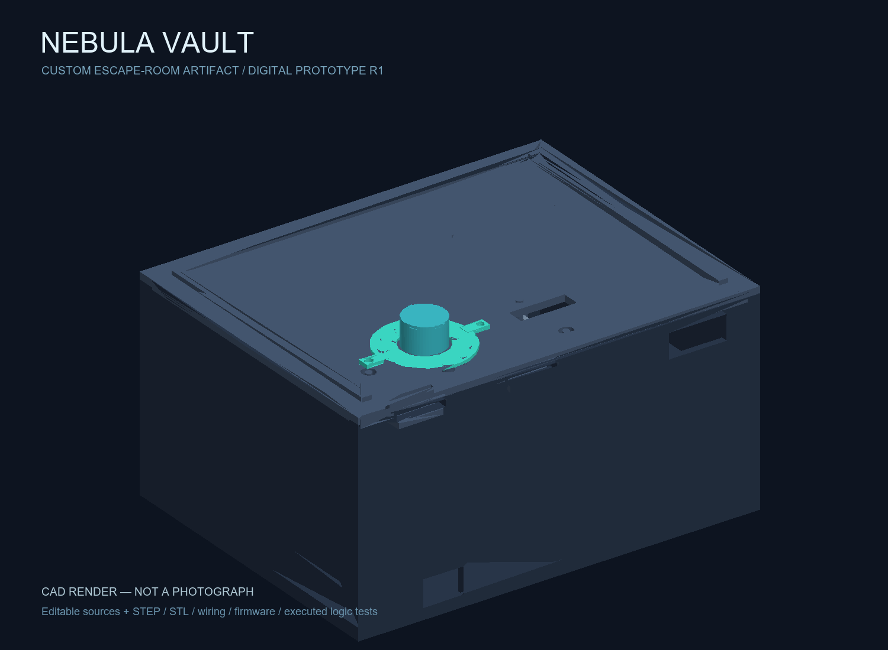
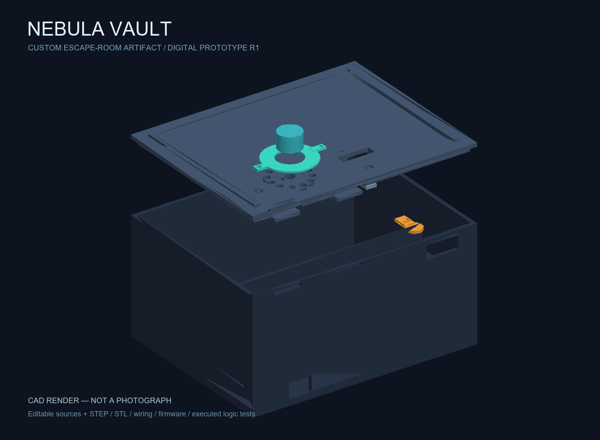

# Existing digital preparation notes

These existing design notes are preserved as supplied factual evidence. The owner states that the underlying work and original notes are his own. Individual session dates and allocations are not supplied here. The owner separately confirmed 20 personal NebulaVault design hours on November 8, 2026; no allocations or session dates were provided. No new journal entries or development chronology have been invented.

##1 — The authenticated dashboard changed the brief

I opened the personal Chrome profile after the school profile reached a login page. The logged-in dashboard identified Freestyle Week, while the public page still advertised Breadboard Logic. I used the dashboard as the current source, then read the tier, shipping and journalling pages. The20-hour floor requires participant evidence and review. I also reviewed the SCARA Robot, Lazy Light and Canard project details to understand the expected technical scope. Next: choose a concept with substantial original mechanics. Evidence: VERIFIED-CHALLENGE.md and evidence/community-*.txt.

##2 — Replacing a timer with an artifact

The first proposed timer concept did not match the requested level of interest. I changed the design to a sci-fi puzzle vault: a luminous encoder ring, directional alignment puzzle, pulse-memory phase and motorized lid catch. I kept the mechanism low force and included an external release slot. The latch is a game prop, not a secure safe. The design uses an editable custom shell and keeper rather than putting a few modules into a bought box. Next: implement the puzzle states and component clearances.

##3 — Making the puzzle testable

I separated the pure puzzle engine from the Pico-specific hardware layer. That let me test the actual state transitions on a desktop without pretending the electronics were connected. The tests include both timing boundary values, rejection immediately outside the tolerance, a missing final tap, reversed direction, reset behavior and a cap on RGB channel values. The intended servo drive lasts650ms and is then removed. This is a control decision, not proof of actual movement or current. Evidence: ../firmware/core.py and ../evidence/test-results.txt. Next: verify that the intended latch can occupy its modeled positions.

##4 — Collision checks found real CAD errors

The first exported CAD model reported68mm³ of lid/body overlap and64mm³ of latch/keeper overlap. I moved the rear retaining hooks below the body tongues and shortened the latch extension so it ends below the keeper roof without entering its wall. The initial annular light opening also left the central encoder island disconnected. I replaced it with twelve individual light ports. The revised geometry report checks the actual exported solids and the intersection volumes. Those are mathematical model results, not dimensional measurements from a printer. Evidence: ../cad/model.py, ../cad/geometry-report.json, ../previews/exploded.png. Next: print the coupon and physically calibrate the mechanism.

##5 — Supply-chain and documentation pass

I selected priced vendor parts, checked availability, and prepared a reconciled BOM. The pre-soldered Pico H listing was unavailable, so the design specifies the Pico with loose headers. The AHCT buffer is used for both the pixels and servo signal, while the display stays on3.3V. I opened a real DigiKey cart and added parts through its shopping controls; the cart-evidence report distinguishes verified additions from remaining purchases. Printing material, consumables and destination-dependent charges are not silently treated as free. Next: resolve every procurement gap before ordering.

## Planned physical sessions — not performed

Print fit coupon; measure the actual encoder shaft and servo; fit-check the lid; solder the harness; inspect shorts; test power with the motor disconnected; calibrate open/locked angles with lid removed; exercise at least50 open/close cycles; check supply dips and motor temperature; photograph the actual build. Record real results and time only when those steps occur. No expected observation in this plan is a claimed test result.

## Digital review illustrations

These are final-state illustrations of work completed for the project, not photographs or evidence that a physical build existed during any entry.

See FINAL-DIGITAL-JOURNAL.md for final vendor decisions and genuine cart images.
